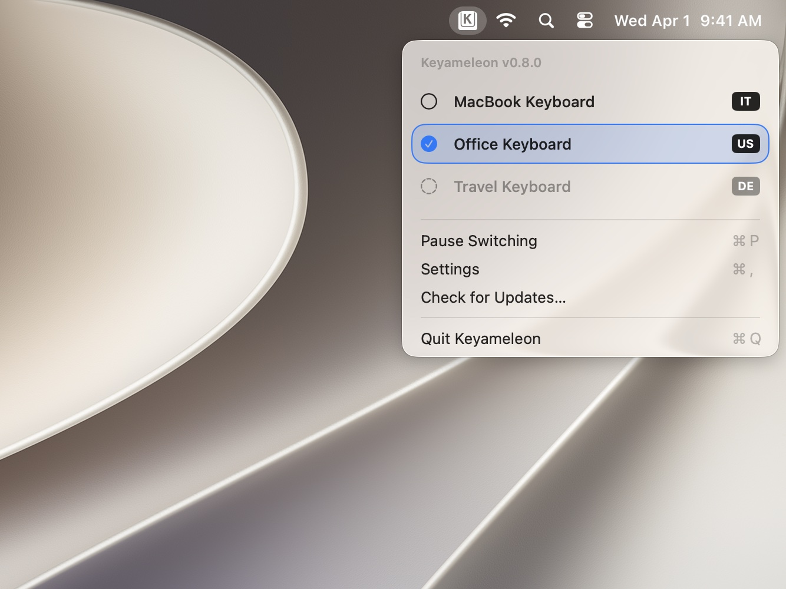
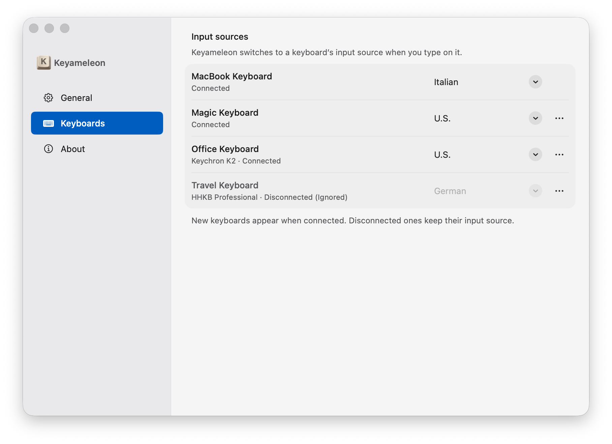
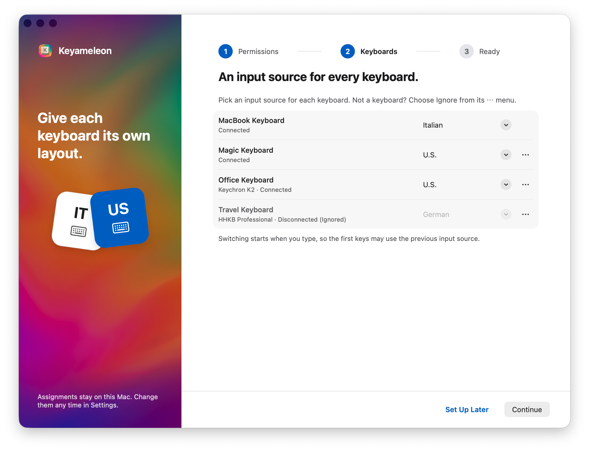

<div align="center">
  <h1>Keyameleon</h1>
  <p><strong>Every keyboard speaks its own language.</strong></p>
  <p>Automatic keyboard layout switching for every keyboard on your Mac.</p>
  <p>
    <a href="https://github.com/mastro993/Keyameleon/releases/latest"></a>
    <a href="https://github.com/mastro993/Keyameleon/actions/workflows/ci.yml"></a>
    
    <a href="LICENSE"></a>
  </p>
  <p>
    <a href="#install">Install</a> ·
    <a href="#how-it-works">How it works</a> ·
    <a href="#privacy">Privacy</a> ·
    <a href="#faq">FAQ</a> ·
    <a href="#build-from-source">Build from source</a> ·
    <a href="https://keyameleon.app/">Website</a>
  </p>
</div>

Keyameleon is an automatic keyboard layout switcher for macOS. It lives in the menu bar and switches the input source to match the keyboard you are typing on, and the app you are typing in. If you use one Mac with keyboards that have different layouts, such as a US MacBook keyboard and an Italian external keyboard, or a Dvorak keyboard next to a QWERTY one, you no longer switch layouts by hand. It works with the built-in keyboard and with USB and Bluetooth keyboards.

<p align="center">
  <picture>
    <source media="(prefers-color-scheme: dark)" srcset="assets/menu-dark.jpg">
    
  </picture>
</p>

## Features

- **One layout per keyboard.** Assign an Input Source to each Physical Keyboard once; Keyameleon remembers it across disconnects and restarts.
- **Automatic switching.** Press a key and Keyameleon selects that keyboard's Input Source, then verifies the change.
- **One layout per app.** Give an app its own Input Source on every keyboard, such as Terminal always on U.S. while your external keyboard types Italian everywhere else. An app's layout wins over the keyboard's while that app is in front.
- **Menu bar only.** No Dock icon once setup is finished. The menu shows your assigned keyboards, which one is active, and any problem that needs attention.
- **Guided setup.** One walkthrough grants Input Monitoring, assigns layouts, and confirms everything is ready.
- **Rename and ignore devices.** Give keyboards your own names, and ignore devices (such as a mouse with shortcut keys) that macOS reports as keyboards.
- **Pause and resume** with <kbd>⌘</kbd><kbd>P</kbd> from the menu.
- **Shortcuts and URLs.** Pause, resume, or select an Input Source from the Shortcuts app, or from a launcher or script with a `keyameleon://` URL. See [Shortcuts and URLs](#shortcuts-and-urls).
- **Launch at login**, if you want it.
- **Updates you approve.** Keyameleon checks for updates at most once a day and never installs one without your approval.
- **Speaks your language.** English, Italian, French, Spanish, Japanese, Korean, Simplified and Traditional Chinese, and Arabic, following your macOS language.

<p align="center">
  <picture>
    <source media="(prefers-color-scheme: dark)" srcset="assets/settings-dark.png">
    
  </picture>
</p>

## Requirements

- macOS 26 or later, on Apple silicon or Intel.
- The **Input Monitoring** permission. Keyameleon uses it to see which keyboard you pressed a key on.

## Install

With [Homebrew](https://brew.sh):

```sh
brew install --cask mastro993/tap/keyameleon
```

Or download `Keyameleon-<version>.dmg` from the [latest release](https://github.com/mastro993/Keyameleon/releases/latest), open it, and drag Keyameleon to Applications.

Both install the same signed and notarized app, and Keyameleon updates itself either way.

### First launch

Guided setup opens on first launch:

1. **Permissions.** Choose **Allow Input Monitoring**, then turn Keyameleon on in System Settings. If macOS asks, choose **Quit & Reopen**. Setup continues by itself once access is granted.
2. **Keyboards.** Pick an Input Source for each keyboard. You can skip this and assign layouts later in Settings.
3. **Ready.** Finish, and Keyameleon stays in the menu bar.

<p align="center">
  <picture>
    <source media="(prefers-color-scheme: dark)" srcset="assets/setup-dark.png">
    
  </picture>
</p>

Keyameleon does not switch layouts and has no menu bar icon until you finish setup. If you close the setup window early, Keyameleon quits; open it again to pick up where you left off. After setup, closing a window never quits the app; use **Quit Keyameleon** in the menu.

## How it works

Keyameleon watches keyboard activity through Apple's CoreHID framework in listen-only mode. When you press a key, it identifies the keyboard, looks up the input source it wants, and asks macOS to select it. It then reads the Input Source back to confirm the switch. The input source it wants is the front app's, if you gave that app one, otherwise the keyboard's. Switching to another app also switches the input source right away.

Things worth knowing:

- **The first key can use the old layout.** Keyameleon never delays or changes your input, so the key press that triggers a switch, and any keys macOS handles before the switch completes, use the previous layout.
- **Each keyboard needs a stable identity.** Keyameleon recognizes an external keyboard by its hardware identity. A keyboard that macOS cannot identify reliably is listed but cannot receive an assignment.
- **Turn off per-document switching.** If **Automatically switch to a document's input source** is on in Keyboard settings, macOS also switches when you change apps, and the two can disagree.
- **Missing layouts are never replaced.** If an assigned Input Source is removed from macOS, Keyameleon keeps the assignment, shows a warning, and does not pick a substitute.
- **Only one copy runs per Mac.** A second copy, even of another version, exits silently on launch.

## Shortcuts and URLs

Keyameleon adds these actions to the Shortcuts app. Find them under Keyameleon when you add an action to a shortcut.

| Action | What it does |
| --- | --- |
| **Pause Switching** | Pauses automatic switching, like **Pause Switching** in the menu. |
| **Resume Switching** | Resumes automatic switching. |
| **Pause or Resume Switching** | Pauses when switching runs, and resumes when it is paused. |
| **Select Input Source** | Selects one of your enabled keyboard layouts. |
| **Get Active Keyboard and Input Source** | Returns the name of the keyboard you last typed on and the current input source. |

Launchers, scripts, and the Terminal can use the same actions through URLs, for example `open keyameleon://pause`. In the Terminal, put a URL that contains `?` in single quotes, such as `open 'keyameleon://select-input-source?id=US'`; otherwise zsh reports `no matches found`.

| URL | What it does |
| --- | --- |
| `keyameleon://pause` | Pauses automatic switching. |
| `keyameleon://resume` | Resumes automatic switching. |
| `keyameleon://toggle-pause` | Pauses when switching runs, and resumes when it is paused. |
| `keyameleon://select-input-source?id=US` | Selects an input source by its identifier, which is the same in every language. Use the full identifier, such as `com.apple.keylayout.US`, or only its last part, such as `US` or `Italian-Pro`. |
| `keyameleon://select-input-source?name=U.S.` | Selects an input source by its full name as Keyameleon's pickers show it. Names follow your language: the same layout is `U.S.` in English and `USA` in Italian. The two-letter badge in the menu, such as `IT`, is not a name. |
| `keyameleon://set-external-change-response?value=switch-back` | Sets **When input source changes externally** in **Settings → General**: `switch-back` (Switch back), `hold-until-match` (Keep until matching keyboard), or `hold-until-keyboard-change` (Keep until another keyboard). |

Selecting an input source from a shortcut or a URL counts as a change outside Keyameleon, like picking one from the menu bar. With the default **Switch back**, your next key press on an assigned keyboard switches back; to keep the new input source, choose another option for **When input source changes externally**, or pause switching first. If Keyameleon is not running, a shortcut or URL opens it in the background.

## Privacy

Keyameleon is monitor-only. It cannot inject or alter keystrokes: CoreHID gives it read access, and layout changes go through the macOS text input system.

What you type never leaves the classification step: no keystrokes, modifiers, or shortcuts reach saved data, log files, or the network. There are no analytics and no automatic uploads. The only network requests are update checks and the updates you approve.

Keyameleon stores data locally:

| What | Where |
| --- | --- |
| Keyboard names and assignments, app assignments | `~/Library/Application Support/Keyameleon/` |
| Setup progress, ignored devices, pause state, External Change Response | Preferences domain `dev.fedemas.keyameleon` |
| Integrity key that protects saved keyboard designations | Keychain item `dev.fedemas.keyameleon.installation-integrity` |
| Operational logs (no typed content) | `~/Library/Logs/Keyameleon/` |

**Settings → About** opens the data and log folders in Finder.

## FAQ

### Can a Mac use a different keyboard layout for each keyboard?

Not on its own. macOS has one active input source for the whole system, and it changes only when you pick another one from the menu bar, press a shortcut, or let it follow the current document. Keyameleon adds the missing rule: give each keyboard an input source once, and it switches when you start typing on that keyboard.

### How is Keyameleon different from per-app layout switchers?

Per-app switchers change the layout when you switch apps; they do not know which keyboard you type on. Keyameleon does both: each keyboard has its layout, and an app can override it on every keyboard while it is in front.

### Does it work with Bluetooth keyboards and the built-in MacBook keyboard?

Yes. The built-in keyboard and USB and Bluetooth keyboards can each have their own input source. A keyboard that macOS cannot identify reliably is listed but cannot receive an assignment; see [How it works](#how-it-works).

### Does Keyameleon read what I type?

It uses key presses only to tell which keyboard is active. Typed content never reaches saved data, log files, or the network. See [Privacy](#privacy).

### Can I switch to another layout for a few words without Keyameleon switching back?

Yes. By default Keyameleon switches back on your next key press when the input source changes outside it, such as with a shortcut, the menu bar, or an input method. In **Settings → General**, set **When input source changes externally** to keep the new input source until you type on a keyboard assigned to it, or until you type on another keyboard. Switching apps always ends it. The menu bar menu then shows **Switch Back Now** to return early.

### Is Keyameleon free?

Yes. It is free and open source under the MIT License.

## Troubleshooting

- **Keyameleon does not switch layouts.** Open the menu. A notice explains what is wrong (missing permission, paused, unavailable layout) and offers the fix.
- **Input Monitoring is on, but Keyameleon says it is off.** Choose **Restart Keyameleon** in the menu. This often happens after reinstalling. If it is still off after the restart, Keyameleon clears its old entry and asks again, so you only have to turn it back on.
- **Something else went wrong.** Attach the relevant lines from `~/Library/Logs/Keyameleon/keyameleon.log` to a [bug report](https://github.com/mastro993/Keyameleon/issues/new/choose).

## Uninstall

Quit Keyameleon from the menu, then delete the app, or run `brew uninstall --cask keyameleon`. To remove its data as well, delete the folders and Keychain item listed under [Privacy](#privacy) and run `defaults delete dev.fedemas.keyameleon`.

## Build from source

You need macOS 26, Xcode 26, [XcodeGen](https://github.com/yonaskolb/XcodeGen), and an Apple Development certificate.

```sh
brew install xcodegen
./Scripts/run.sh open   # generate the project, build a Debug app, and launch it
./Scripts/run.sh test   # safety audit, SwiftLint, and the full test suite
```

[`docs/development.md`](docs/development.md) covers signing, project generation, and the repository layout.

## Documentation

| Document | Contents |
| --- | --- |
| [`CONTEXT.md`](CONTEXT.md) | Product vocabulary: Physical Keyboard, Input Source, Keyboard Assignment, and more |
| [`docs/development.md`](docs/development.md) | Building, signing, and repository layout |
| [`docs/testing.md`](docs/testing.md) | Automated tests, CI, and manual verification checklists |
| [`docs/choices.md`](docs/choices.md) | Current design decisions, by feature |
| [`docs/adr/`](docs/adr) | Architecture decision records |
| [`docs/release/official-release.md`](docs/release/official-release.md) | How Official Releases are signed, published, and verified |

## Contributing

Bug reports, feature ideas, and pull requests are welcome. Read [`CONTRIBUTING.md`](CONTRIBUTING.md) first. Report security issues privately as described in [`SECURITY.md`](SECURITY.md).

## License

Keyameleon is released under the [MIT License](LICENSE). It uses [Sparkle](https://sparkle-project.org) for updates; see [`THIRD_PARTY_NOTICES.md`](THIRD_PARTY_NOTICES.md).
